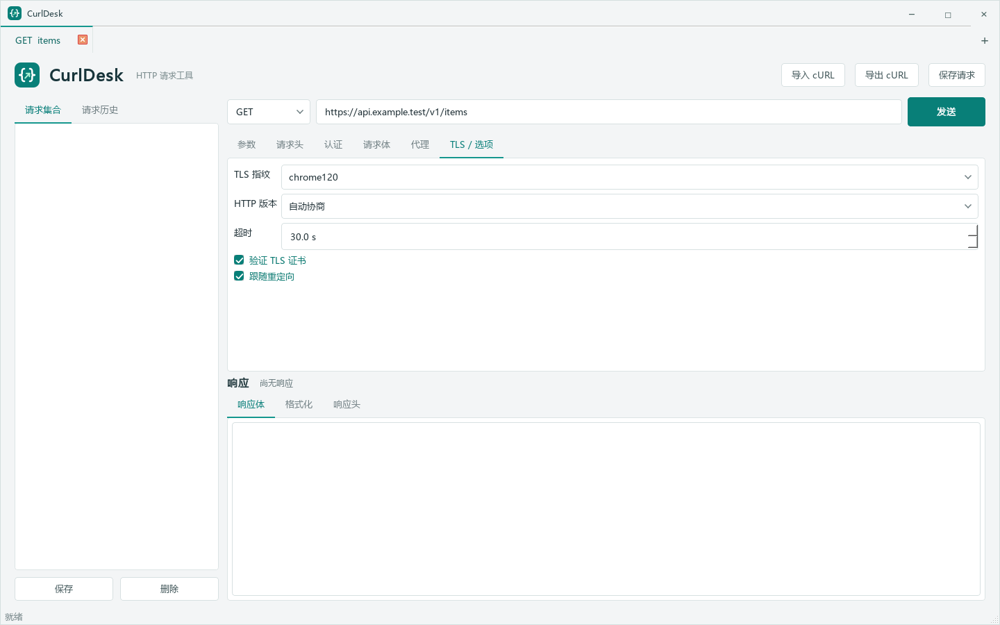

# CurlDesk

[简体中文](README.md)

CurlDesk is an open-source Windows desktop request client built specifically around browser TLS fingerprint simulation. Most general-purpose API clients do not offer selectable browser TLS fingerprints. CurlDesk uses `curl_cffi` to make fingerprint selection part of each request, alongside the request editing, cURL import/export, and response inspection tools needed for API debugging.

## Features

- Common HTTP methods, URL parameters, headers, Bearer Token, and Basic Auth.
- JSON, URL-encoded forms, multipart forms with file uploads, and raw text bodies.
- Per-request HTTP, HTTPS, or SOCKS5 proxy settings, including proxy authentication.
- Per-request browser TLS fingerprints supported by `curl_cffi`; Chrome 120 is the default fingerprint.
- Import common Bash, CMD, and PowerShell cURL commands; export a PowerShell `curl.exe` command and copy it to the clipboard.
- Run requests in the background, inspect status, timing, headers, and body, and cancel an active request.
- Automatically format and syntax-highlight JSON and JSONP while preserving the original response and JSONP callback name.
- Store collections and the most recent 500 request history entries in a local SQLite database.

> Note: an exported system `curl.exe` command cannot preserve `curl_cffi` TLS fingerprint emulation. Run the request in CurlDesk when you need a browser fingerprint.

## Screenshots



The screenshot shows the TLS fingerprint selector, the Chrome 120 default, and per-request proxy settings. The example URL and local proxy address are shown for illustration only.

## Requirements

- Windows 10 or later
- Python 3.10
- Python Launcher (`py`)

## Download

Open [Releases](https://github.com/Cenita/CurlDesk/releases/latest) to download the latest `CurlDesk.exe`. Each release also includes a SHA-256 checksum file.

## Run

Open PowerShell in the project directory:

```powershell
Set-ExecutionPolicy -Scope Process Bypass
./run.ps1
```

On first run, the script creates `.venv` and installs the dependencies from `requirements.txt`.

Alternatively, set up and run the app manually:

```powershell
py -3.10 -m venv .venv
.\.venv\Scripts\python.exe -m pip install -r requirements.txt
.\.venv\Scripts\python.exe main.py
```

## Build A Single-File EXE

```powershell
./build.ps1
```

The executable is written to `dist\CurlDesk.exe`. PyInstaller output and build files are excluded from Git.

## Tests

```powershell
$env:QT_QPA_PLATFORM = "offscreen"
.\.venv\Scripts\python.exe -m unittest discover -s tests -v
```

GitHub Actions runs the same test suite on Windows with Python 3.10.

## Data And Security

Collections and request history are stored in `%APPDATA%\CurlDesk\curldesk.sqlite3`. The current version stores request headers, cookies, tokens, passwords, and proxy credentials in **plain text**. Do not save sensitive requests on an untrusted device, and never commit real credentials, cookies, exported requests, or the database to this repository. Deleting a collection does not delete its history entries.

Requests are sent directly to the target URL you enter, using the configured proxy and TLS settings. Only access services and use credentials you are authorized to use.

## Dependencies

The main dependencies are `curl_cffi`, PySide6 Essentials, and PyInstaller. Each dependency is governed by its upstream license. The source code license is in [LICENSE](LICENSE).

## Contributing

Bug reports and improvements are welcome. Please read the [contribution guide](CONTRIBUTING.md) and [security policy](SECURITY.md) before submitting.

## License

This project is released under the MIT License. See [LICENSE](LICENSE).
